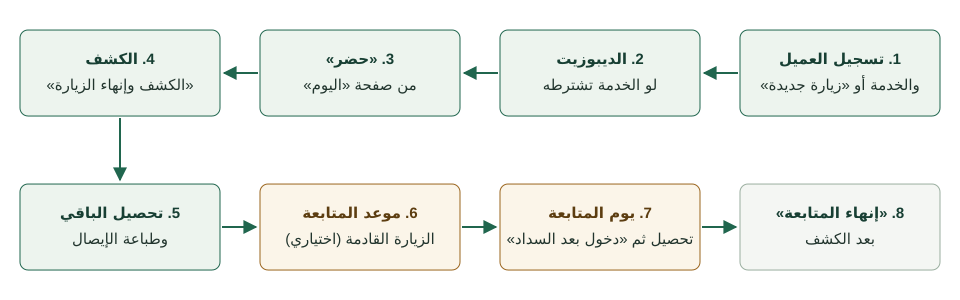

# دليل استخدام نظام فاميلي كير

**الإصدار:** 3.0 — **تاريخ المراجعة:** 14/11/2026

[نسخة PDF جاهزة للطباعة والمشاركة](family-care-user-guide-ar.pdf)

> **إيه الشغال دلوقتي وإيه اللي مستني تحديث قاعدة البيانات؟**
> الموقع https://family-care-4le.pages.dev شغال بالواجهة الجديدة. الخصائص المعلّمة بـ **[بعد تحديث القاعدة]** بتظهر بعد ما المالك يوافق على تحديث قاعدة البيانات ويتطبق. لحد ده ما يحصل الخانات دي بتفضل مخفية، وباقي البرنامج شغال عادي.
> كل الأسماء والأرقام اللي في الأمثلة وهمية.

## المحتويات

1. عن الدليل والبرنامج
2. الدخول والخروج والتنقل والبحث
3. الصلاحيات: المالك والاستقبال والطبيب
4. رحلة العميل في العيادة
5. صفحة «اليوم»
6. العملاء: البحث وملف العميل
7. تسجيل عميل جديد
8. حجز زيارة وخدمات
9. صفحة الزيارة: الخدمات والتحصيل والطباعة
10. الكشف وإنهاء الزيارة وموعد الزيارة القادمة
11. المتابعات
12. مواعيد الدكاترة
13. المصروفات
14. العروض والرسائل
15. دليل الطبيب
16. حسابات الموظفين (المالك)
17. التخصصات والخدمات وفئات الأطباء (المالك)
18. قوائم الأسعار (المالك)
19. الأطباء ونسبهم وكشف الحساب (المالك)
20. عقود الإيجار وتحصيله (المالك)
21. التأمين والنقابات (المالك)
22. التقارير والتصدير (المالك)
23. تقييم العملاء (المالك)
24. إعدادات العيادة وقوالب الرسائل (المالك)
25. العمليات المالية العكسية والإلغاء
26. رسائل الخطأ الشائعة وحلها
27. أسئلة شائعة
28. قائمة سريعة لموظف الاستقبال
29. قائمة سريعة للطبيب
30. قائمة المالك
31. معاني الكلمات

## 1. عن الدليل والبرنامج

البرنامج فيه كل ملفات العملاء وزياراتهم وخدماتهم وتحصيلاتهم ومتابعاتهم، وحسابات الأطباء والتأمين والإيجار والمصروفات، في مكان واحد.

- **موظف الاستقبال:** يبدأ من القسم 2 للقسم 14، وبعدهم القائمة السريعة في القسم 28.
- **الطبيب:** يقرا القسم 2 و3، وبعدهم «دليل الطبيب» في القسم 15، والقائمة السريعة في القسم 29.
- **المالك:** يقرا الدليل كله، وخصوصًا الأقسام من 16 لـ 25.

**قواعد ثابتة في كل البرنامج:**

- الفلوس بالجنيه وبحد أقصى رقمين بعد العلامة، مثل `350` أو `350.50`.
- التواريخ بصيغة يوم/شهر/سنة، مثل `07/10/2026`، وبتوقيت القاهرة.
- الأسبوع بيبدأ يوم السبت.
- أي حاجة اتسجلت فلوس عليها مش بتتمسح. الغلط بيتصلح بعملية عكسية مسجلة (القسم 25).
- البرنامج بيشتغل على الكمبيوتر والموبايل.

## 2. الدخول والخروج والتنقل والبحث

1. افتح الموقع من الكمبيوتر أو الموبايل.
2. اكتب «البريد الإلكتروني» و«كلمة المرور» اللي أداهم لك المالك. زر «إظهار» يعرض كلمة المرور اللي كتبتها عشان تتأكد منها.
3. اضغط «دخول إلى النظام». تفتح صفحة «اليوم».

4. القائمة الجانبية بتعرض الصفحات المسموحة لحسابك بس. على الموبايل افتحها من زر القائمة ☰.
5. **البحث عن عميل:** اكتب في شريط البحث فوق الصفحة الاسم أو رقم الموبايل أو كود العميل. الاختصار `Ctrl+K` بيوديك للبحث على طول، و`Enter` يفتح أول نتيجة.
6. زر «تحديث» فوق الصفحة بيجيب آخر البيانات من الخادم. استخدمه لو زميلك عدّل حاجة من جهاز تاني.
7. لما تخلص اضغط «تسجيل الخروج» تحت القائمة، وخصوصًا لو الجهاز مشترك.

**كتابة التاريخ:** اكتبه بالأرقام العادية أو العربي، أو اختاره من زر «فتح التقويم» جنب الخانة. التاريخ الغلط زي `31/04/2026` أو `29/02/2025` بيترفض برسالة واضحة.

**لو فضلت رسالة «جارٍ فتح العيادة…» فترة طويلة:** استنى شوية. لو الصفحة ما فتحتش هيظهر زر «إعادة المحاولة»، اضغطه. وما تقفلش نافذة فيها تحصيل لسه ما اتحفظش.

## 3. الصلاحيات: المالك والاستقبال والطبيب

| الشاشة | المالك | الاستقبال | الطبيب |
|---|---|---|---|
| اليوم، العملاء، المتابعات | نعم | نعم | زياراته وعملاؤه بس، من غير مبالغ |
| التخصصات والخدمات | إضافة وتعديل | عرض بس | عرض بس |
| مواعيد الدكاترة | نعم | نعم | لا |
| العروض والرسائل | نعم | نعم | لا |
| المصروفات | كل المصروفات | اللي سجّلها هو بس | لا |
| الأطباء والحسابات | كل الأطباء | لا | «حسابي» بس |
| التأمين والنقابات، تقييمات العملاء، التقارير، الإعدادات | نعم | لا | لا |

- الصلاحيات مطبقة على البيانات نفسها في الخادم، مش مجرد إخفاء زراير.
- الطبيب ما يشوفش عميل غير لو ليه زيارة معاه، وما يشوفش زيارات العميل مع أطباء أو تخصصات تانية ولا تحصيلاته.
- **نسب الأطباء ونصيبهم:** المالك يشوفها كلها، وكل طبيب يشوف نسبته بس. الاستقبال بيحجز ويحصّل من غير ما يشوف النسب. **[بعد تحديث القاعدة]**

## 4. رحلة العميل في العيادة

1. **التسجيل والحجز:** عميل جديد من «تسجيل عميل وخدمة»، أو عميل قديم من ملفه بزر «زيارة جديدة» (القسم 8).
2. **الديبوزيت:** لو الخدمة بتشترط ديبوزيت، الحجز بيفضل «بانتظار الديبوزيت» لحد ما يتسجل (القسم 9).
3. **الحضور:** لما العميل يوصل اضغط «حضر» في صفحة «اليوم» (القسم 5).
4. **الكشف:** الطبيب أو الاستقبال يسجل الكشف ويضغط «حفظ وإنهاء الزيارة» (القسم 10).
5. **التحصيل:** سجّل اللي اتدفع واطبع الإيصال. الباقي بيفضل متبقي على العميل.
6. **الزيارة القادمة:** حدد «موعد المتابعة» وقت إنهاء الزيارة، أو من «متابعة جديدة».
7. **يوم المتابعة:** حصّل المطلوب، وبعدها «دخول بعد السداد» (القسم 11).
8. **بعد الكشف:** «إنهاء المتابعة».

## 5. صفحة «اليوم»

دي أول صفحة بتفتح. فيها حجوزات اليوم والمتابعات اللي محتاجة إجراء. الطبيب بيشوفها باسم «عيادتي اليوم».

- **«تاريخ العمل»:** غيّره عشان تشوف حجوزات يوم تاني. جنبه هتلاقي العدد: كام حجز، وكام متابعة مستحقة، وكام قادمة.
- زر «البحث عن عميل / حجز زيارة» بيفتح صفحة العملاء.

### جدول «الحجوزات»

| العمود | معناه |
|---|---|
| الوقت، العميل، الطبيب | بيانات الحجز. اضغط اسم العميل يفتح ملفه |
| الحالة | «بانتظار الديبوزيت» أو «مؤكدة» أو «حضر» أو «مكتملة» أو «ملغي» |
| المطلوب على العميل، المدفوع، المتبقي | حساب الزيارة (مش بيظهر للطبيب) |

- **«فتح الزيارة»:** يفتح صفحة الزيارة.
- **«حضر»:** بيظهر لما الحجز يكون «مؤكدة». اضغطه أول ما العميل يوصل.
- **«إلغاء الحجز»:** بيلغي الموعد بس. سجل الزيارة والتحصيل بيفضلوا محفوظين.

### «المتابعات المستحقة» و«المتابعات القادمة»

- **المستحقة:** متابعات النهارده والمتأخرة، بعلامة «اليوم» أو «متأخرة». التصنيف ده حسب تاريخ النهارده الفعلي بتوقيت القاهرة، حتى لو غيّرت «تاريخ العمل».
- **القادمة:** أقرب 10 متابعات جاية.
- «فتح الحساب» يفتح حساب المتابعة، و«إدارة المتابعات» يفتح صفحة المتابعات.

## 6. العملاء: البحث وملف العميل

### البحث

افتح «العملاء» واكتب في «بحث العميل» الاسم أو الموبايل أو الكود. الجدول بيعرض: الاسم، والموبايل، والكود، ونوع العميل. لو ليه أكواد قديمة بتظهر تحت كلمة «سابقاً».

- زر «زيارة جديدة» في الصف بيحجز للعميل على طول.
- الملفات التجريبية عليها علامة «تجريبي».

### ملف العميل

اضغط اسم العميل. فوق هتلاقي اسمه، وكوده، وموبايله، ونوعه.

- **البيانات:** الأكواد، وتاريخ الميلاد، والنقابة لو عميل نقابة، وموافقته على العروض والمتابعات، والملاحظات.
- **الحساب:** «حصة العميل» من كل الزيارات، و«المحصّل»، و«المتبقي».
- **«الزيارات»:** لكل زيارة: التاريخ، والطبيب، والحالة، ونسبة العميل، والإجمالي، وحصته، والمدفوع، والمتبقي، واللي على الجهة. «فتح الزيارة» يفتحها.
- **«المتابعات»:** الموعد، والغرض، والحالة.
- **«سجل التحصيل»:** كل إيصالات العميل.

**الزراير:**

- «تعديل البيانات»: لتعديل الاسم أو الرقم أو النوع أو الموافقات. الكود ما بيتغيرش.
- «زيارة جديدة»: حجز بخدمة (القسم 8).
- «حجز فقط»: حجز من غير خدمة.
- «كل العملاء»: يرجعك لقائمة العملاء.

## 7. تسجيل عميل جديد

### ابحث الأول

قبل ما تسجل عميل جديد، ابحث برقم موبايله. لو طلع موجود، احجز له من ملفه، وما تعملوش ملف تاني.

### عميل من غير زيارة

1. افتح «العملاء» واضغط «عميل فقط».
2. اكتب «اسم العميل» و«رقم الموبايل». الرقم المحلي زي `01012345678` بيتحفظ لوحده بالصيغة الدولية `+201012345678`.
3. اختار «نوع العميل». لو «عميل آجل تأمين» اختار «شركة التأمين»، ولو «عميل نقدي نقابة» اختار «النقابة».
4. «تاريخ الميلاد» اختياري، وبيستخدم لرسالة عيد الميلاد.
5. «التخصص (اختياري)» بيستخدم للعروض والرسائل حسب التخصص بس.
6. علّم كل موافقة لوحدها: «وافق على رسائل العروض وأعياد الميلاد»، و«وافق على رسائل مواعيد المتابعة». سيب اللي ما وافقش عليه من غير علامة.
7. «ملاحظات الملف» اختيارية.
8. اضغط «حفظ». يفتح ملف العميل.

### كود العميل الدائم [بعد تحديث القاعدة]

- كل عميل ليه كود واحد ثابت زي `FC-000123`، لكل التخصصات.
- العميل اللي كشف أسنان النهارده وهيكشف جلدية الأسبوع الجاي يتحجز له من نفس الملف وبنفس الكود. **ما تسجلوش مرة تانية.**
- الكود ما بيتغيرش أبدًا، حتى لو عدّلت الاسم.
- الأكواد القديمة المطبوعة زي `DEN-000382` لسه بتفتح نفس الملف من البحث.
- الكود بيظهر في البحث، وملف العميل، وصفحة الزيارة، والإيصالات والفواتير.

### رقم موبايل مسجل لعميل تاني

ممكن أفراد الأسرة يستخدموا رقم واحد. لما تكتب رقم مسجل قبل كده:

1. هتظهر رسالة «الرقم مسجل بالفعل باسم:» ومعاها زر «فتح ملف …» لكل عميل بالرقم ده.
2. لو هو نفس العميل، اضغط «فتح ملف …» واحجز له من ملفه.
3. لو فرد تاني من الأسرة، علّم «ملف منفصل لنفس الرقم (فرد آخر من الأسرة)» واضغط «حفظ».

البرنامج عمره ما بيدمج ملفين لوحده.

## 8. حجز زيارة وخدمات

### عميل جديد وزيارته في خطوة واحدة

**مثال:** عميل جديد عايز كشف أسنان النهارده ومعاه خدمتين.

1. افتح «العملاء» واضغط «تسجيل عميل وخدمة».
2. اكتب الاسم والرقم، واختار «نوع العميل».
3. «تاريخ الزيارة» بيبقى النهارده لوحده بتوقيت القاهرة. لو الحجز ليوم تاني غيّره **الأول**.
4. اختار «تخصص الزيارة»، وبعده «الطبيب والتخصص». القائمة بتعرض بس الأطباء اللي متاحين في التاريخ المختار.
5. اختار «الخدمة».
6. لخدمة زيادة اضغط «إضافة خدمة أخرى» واختار الخدمة والعدد. «إلغاء الخدمة» جنبها بيشيلها قبل الحفظ.
7. لعميل التأمين أو النقابة اكتب «نسبة تحمّل العميل من الكارنيه (%)» للزيارة دي.
8. اختياري: «المدفوع الآن بالجنيه» و«طريقة الدفع». اكتب صفر لو هتحصّل بعد ما تفتح الزيارة.
9. راجع المعاينة اللي تحت النموذج: سعر الخدمة، واللي على العميل، واللي على الجهة، والمدفوع، والمتبقي.
10. اضغط «تسجيل العميل والخدمة». تفتح صفحة الزيارة.

### عميل مسجل قبل كده

1. ابحث عنه وافتح ملفه.
2. اضغط «زيارة جديدة».
3. اختار التاريخ، و«تخصص الزيارة»، والطبيب، والخدمة، و«الوقت» لو عايز.
4. «مكان الزيارة»: «العيادة» أو «منزلية (+ 1,000 جنيه)». رسم الزيارة المنزلية بيتضاف مرة واحدة بس.
5. اضغط «تسجيل الزيارة والخدمة».

**«حجز فقط»:** بيحجز موعد من غير خدمة. اختار التاريخ والطبيب والوقت والمكان، واضغط «حفظ الحجز»، والخدمات تتضاف بعدين من صفحة الزيارة.

### خدمة سعرها يحدده الاستقبال [بعد تحديث القاعدة]

بعض الخدمات ملهاش سعر ثابت، زي خدمات التخصصات الجديدة: علاج طبيعي، وجلدية وتجميل، ونفسية، وتغذية، وزيارات منزلية. لما تختار خدمة منهم هتظهر خانة «سعر الخدمة بالجنيه».

1. اكتب السعر اللي اتفقت عليه مع العميل للوحدة الواحدة. الإجمالي = السعر × العدد.
2. سجّل «المدفوع الآن»، والباقي بيتسجل متبقي على العميل.
3. السعر بيتحفظ في الزيارة دي بس، والمالك بيشوفه في سجل التعديلات.

نفس الخانة بتظهر في «إضافة خدمة أخرى» وفي «إضافة خدمة» من صفحة الزيارة. لو الخدمة هدية مش محتاج تكتب سعر.

### عميل تأمين أو نقابة

اكتب نسبة تحمّل العميل اللي على الكارنيه **في كل زيارة**.

**مثال:** زيارة بـ 300 جنيه ونسبة العميل 20%: العميل يدفع 60 جنيه والجهة عليها 240 جنيه. حصة العميل بتتقرّب لأقرب قرش، وحصة الجهة هي الباقي بالظبط، فالمجموع دايمًا بيساوي الإجمالي.

## 9. صفحة الزيارة: الخدمات والتحصيل والطباعة

فوق الصفحة هتلاقي اسم العميل، وكوده، والتاريخ، والتخصص، والطبيب، والمكان، وحالة الزيارة: «مفتوحة» أو «مكتملة» أو «ملغاة». الزراير اللي هناك: «ملف العميل»، و«متابعات / دخول هذا الحساب».

**ملخص الحساب:** «الإجمالي»، و«حصة العميل»، و«على الجهة»، و«المحصّل»، و«المتبقي».

### الديبوزيت وتأكيد الحجز

لو الخدمة بتشترط ديبوزيت هتظهر رسالة «الحجز بانتظار ديبوزيت … جنيه»، والحجز هيفضل «بانتظار الديبوزيت».

1. اضغط «تسجيل تحصيل». «النوع» بيبقى «ديبوزيت حجز» لوحده.
2. سجّل المبلغ. لما يوصل المطلوب، الحجز يبقى «مؤكدة»، وزر «حضر» يظهر في «اليوم».

لو الجهة بتغطي الزيارة كلها، مفيش ديبوزيت ولا حصة على العميل.

### إضافة خدمة أو إلغاؤها

- **«إضافة خدمة»:** اختار الخدمة، و«الطبيب المنفذ»، و«العدد». علّم «هدية بدون مقابل» لو الخدمة ببلاش. اضغط «إضافة الخدمة».
- **الباقة:** بتظهر بعلامة «باقة»، وخدماتها الهدية بعلامة «هدية».
- **«إلغاء الخدمة»:** متاح قبل أي تحصيل. لو الخدمة جزء من باقة، الباقة كلها بتتلغي بخدماتها.
- **بعد التحصيل:** «إضافة خدمة» لسه متاح وبيزوّد الإجمالي. الإيصالات القديمة ما بتتغيرش، ومينفعش تمسح خدمة اتحصّل عليها فلوس. التصحيح بيبقى بعملية عكسية مسجلة (القسم 25).

### كود العرض

اضغط «تطبيق كود عرض»، واكتب «كود العرض»، واضغط «تطبيق العرض». طبّقه **بعد** ما تضيف الخدمات و**قبل** أي تحصيل. الخدمات اللي تتضاف بعد العرض بتتحسب بسعرها الكامل.

### التحصيل والإيصال

**مثال:** إجمالي الزيارة 600 جنيه.

1. اضغط «تسجيل تحصيل».
2. اكتب «المبلغ بالجنيه» `200`، واختار «طريقة الدفع» («نقدي» أو «بطاقة» أو «تحويل») و«النوع» («تحصيل» أو «ديبوزيت حجز»).
3. اضغط «تسجيل وطباعة الإيصال». الإيصال هيظهر وفيه: حساب العميل وقت الدفع، وإجمالي المدفوع، و«المتبقي بعد الدفعة» وهو 400 جنيه.
4. اضغط «طباعة الإيصال». ولو العميل جاي لمتابعة، اضغط «العودة للمتابعة وتسجيل الدخول».
5. في الزيارة الجاية افتح نفس الزيارة وسجّل الـ 400 جنيه، فيبقى المتبقي 0.

- البرنامج مش بيقبل مبلغ أكبر من المتبقي.
- لو ضغطت مرتين، أو النت قطع وعدت المحاولة من نفس النافذة، الإيصال مش بيتسجل مرتين.
- كل إيصال بيحفظ اسم الموظف اللي حصّله.
- «عرض / طباعة» في جدول «التحصيل والإيصالات» بيعيد طباعة أي إيصال.

### الفاتورة

«عرض / طباعة الفاتورة» بيعرض الخدمات بأسعارها، والإجمالي، وحصة العميل، واللي على الجهة، والمدفوع، والمتبقي. اضغط «طباعة الفاتورة» لطباعتها. الفاتورة ملخص محدّث للحساب، والإيصالات القديمة محفوظة زي ما هي.

## 10. الكشف وإنهاء الزيارة وموعد الزيارة القادمة

1. في صفحة الزيارة اضغط «الكشف وإنهاء الزيارة».
2. اكتب «التشخيص / ملاحظات الكشف»، واختياريًا «تعليمات العميل».
3. **موعد الزيارة القادمة:** اكتب «موعد المتابعة (اختياري)»، وبعده «وقت المتابعة» و«غرض المتابعة»، واختار «حساب المتابعة» (القسم 11).
4. اضغط «حفظ وإنهاء الزيارة». الزيارة تبقى «مكتملة».

- الطبيب بيستحق نصيبه لما الزيارة تخلص، حتى لو الفلوس لسه ما اتحصّلتش كلها.
- بعد الإنهاء الزرار بيبقى اسمه «تعديل الكشف / إضافة متابعة».
- **تذكير العميل:** العميل اللي وافق على رسائل المتابعة بيتسجل له تذكير قبل الموعد بعدد الأيام اللي في «إعدادات العيادة». الرسايل لسه مش بتتبعت فعليًا (القسم 14).
- **لو التاريخ فات:** هيظهر «تأكيد: التاريخ ده فات، وهتتسجل كمتابعة متأخرة». علّمه بس لو بتسجل متابعة قديمة وانت قاصد.

## 11. المتابعات

### تسجيل متابعة

من صفحة الزيارة اضغط «متابعة جديدة»، أو حددها من «الكشف وإنهاء الزيارة». اكتب «التاريخ» و«الوقت» و«الغرض»، واختار «حساب المتابعة»:

- **«استكمال نفس الخدمة / تحصيل الباقي»:** مفيش خدمة جديدة ولا سعر جديد. يوم المتابعة بيتحصّل الباقي من نفس الحساب.
- **«متابعة بسعر مستقل»:** اكتب «سعر المتابعة بالجنيه»، مثل `200`. المبلغ ده على العميل كله، حتى لو تأمين أو نقابة. الطبيب ما يقدرش يختار النوع ده.

### صفحة «المتابعات»

1. اختار من «عرض»: «اليوم» أو «متأخرة» أو «قادمة» أو «كل المتابعات».
2. في كل صف هتلاقي: العميل والمطلوب منه، والتاريخ والوقت، والطبيب والغرض والحالة، و«باقي الحساب الأصلي»، و«سعر المتابعة»، و«المطلوب قبل الدخول».
3. اضغط «فتح / تحصيل المتابعة»، واختار «نوع المتابعة» (الأنواع تحت).
4. اضغط «فتح الحساب»، وحصّل المطلوب من صفحة الزيارة.
5. ارجع لصفحة المتابعات واضغط «دخول بعد السداد». الزرار ده ما بيشتغلش غير بعد سداد كل المطلوب.
6. بعد الكشف اضغط «إنهاء المتابعة».

| نوع المتابعة | معناه |
|---|---|
| استكمال نفس الخدمة / تحصيل باقي الحساب | من غير سعر جديد، بيتحصّل الباقي من نفس الحساب |
| المتابعة بالسعر المحجوز | لو المتابعة متسجلة بسعر مستقل |
| خدمة جديدة بمقابل | زيارة جديدة بخدمة مدفوعة بسعر القائمة. اختار «خدمة المتابعة المدفوعة» و«تاريخ الزيارة الجديدة»، وللتأمين نسبة التحمل |

- «تغيير الموعد» بينقل المتابعة لتاريخ جديد، والموعد القديم بيفضل في السجل.
- «لم يحضر» بيقفل المتابعة كغياب.
- الخدمات اللي سعرها بيحدده الاستقبال مش بتظهر في «خدمة جديدة بمقابل»، فاستخدم «استكمال الحساب» أو «متابعة بسعر مستقل». **[بعد تحديث القاعدة]**

## 12. مواعيد الدكاترة

افتح «مواعيد الدكاترة» واختار «التخصص». هتظهر أسامي الدكاترة وأيام عمل كل واحد. الصفحة دي للعرض بس، ولتعديل الأيام اضغط «تعديل أيام عمل الدكاترة» (المالك).

وقت الحجز، قائمة الأطباء بتعرض بس اللي متاحين في تاريخ الزيارة. عشان كده اختار التاريخ الأول، وبعده التخصص، وبعده الطبيب.

## 13. المصروفات

1. افتح «المصروفات» واضغط «تسجيل مصروف».
2. اكتب «المبلغ بالجنيه» و«تاريخ المصروف». التاريخ المستقبلي مش مقبول.
3. اختار «البند» و«طريقة الدفع».
4. اكتب «سبب الصرف» و«اسم المستلم (اختياري)»، مثل «عامل تصليح الكرسي».
5. اضغط «حفظ المصروف».

- الاستقبال بيشوف المصروفات اللي سجلها هو بس، والمالك بيشوف الكل.
- فوق الجدول هتلاقي «إجمالي المصروفات» و«عدد المصروفات». غيّر «من» و«إلى» و«كل البنود» للفلترة.
- «تفصيل حسب البند» بيجمع المصروفات حسب نوعها.
- «تصدير CSV» و«طباعة» للحفظ.
- «إلغاء المصروف» للمالك بس، ولازم يكتب «سبب الإلغاء» (القسم 25).

## 14. العروض والرسائل

### عرض جديد

1. افتح «العروض والرسائل» واضغط «عرض جديد».
2. اكتب «عنوان العرض»، واختار «التخصص»، واكتب «كود العرض»: حروف إنجليزي وأرقام وشرطة، من 3 لـ 30 حرف.
3. اختار «نوع الخصم»: «نسبة» واكتب «نسبة الخصم (%)»، أو «مبلغ» واكتب «قيمة الخصم بالجنيه».
4. حدد الصلاحية «من» و«إلى».
5. اختياري: «حد الاستخدام (اختياري)» لعدد مرات كلي، و«يشمل الباقات»، و«يستخدم في رسالة عيد الميلاد».
6. **«مرة واحدة لكل عميل»:** بيمنع نفس العميل يستخدم العرض تاني، حتى لو جهازين حاولوا في نفس اللحظة. لو مش متعلّمة، العميل يقدر يستخدم العرض في أكتر من زيارة. العروض القديمة فضلت متكررة زي ما كانت. **[بعد تحديث القاعدة]**

### حملة عروض

1. في «حملة عروض» اختار العرض والفلاتر: التخصص، ونوع العميل، و«آخر زيارة من» و«آخر زيارة إلى».
2. «معاينة المستلمين» بيعرض عدد العملاء الموافقين على العروض بس.
3. «تسجيل إرسال تجريبي» بيسجل الحملة في السجل.

### الرسائل

- **الرسايل مش بتتبعت فعليًا دلوقتي.** البرنامج بيسجلها في «سجل الرسائل» بحالة «مسجلة تجريبياً» بس. مفيش واتساب ولا SMS ولا بريد.
- تذكيرات المتابعة بتتسجل للعملاء الموافقين على رسائل المتابعة بس. اللي مش موافق بيتسجل له «لم تُرسل».
- «تشغيل فحص التذكيرات الآن» بيعمل الفحص على طول بدل ما يستنى الفحص التلقائي اللي بيحصل كل 5 دقايق.
- «سجل الرسائل» بيتفلتر حسب النوع: عيد ميلاد، أو حملة، أو متابعة، أو تقييم تجربة.

## 15. دليل الطبيب

الطبيب بيشوف زياراته وعملاءه بس، ومن غير أي مبالغ أو تحصيلات.

1. **«عيادتي اليوم»:** حجوزاتك في «تاريخ العمل»، ومتابعاتك المستحقة والقادمة. اضغط «فتح الزيارة».
2. **صفحة الزيارة:** بتعرض الخدمات وأسعارها وقت الزيارة. ما تقدرش تضيف خدمات ولا تحصّل، ده شغل الاستقبال.
3. **الكشف:** اضغط «الكشف وإنهاء الزيارة»، واكتب «التشخيص / ملاحظات الكشف» و«تعليمات العميل». لو عايز تحدد الزيارة الجاية اكتب «موعد المتابعة» و«غرض المتابعة»، واضغط «حفظ وإنهاء الزيارة».
4. **المتابعة:** الطبيب بيسجل «استكمال نفس الخدمة / تحصيل الباقي» بس. المتابعة بسعر مستقل بيسجلها الاستقبال.
5. **صفحة «المتابعات»:** هتلاقي «بانتظار الاستقبال والسداد» لحد ما الاستقبال يسجل الدخول. وتقدر تضغط «تغيير الموعد» أو «لم يحضر».
6. **«حسابي»:** حدد «من» و«إلى» واضغط «عرض الحساب». هتشوف الخدمات المنفذة، ونسبتك، ونصيبك المستحق، و«فرق تعديل النسبة» لو المالك غيّرها. «تصدير CSV» و«طباعة» للحفظ.

## 16. حسابات الموظفين (المالك)

### حساب استقبال

1. افتح «الإعدادات» وبعدها تبويب «الحسابات».
2. اضغط «حساب استقبال جديد».
3. اكتب «البريد الإلكتروني»، و«كلمة المرور» (12 حرف على الأقل)، و«اسم الموظف».
4. اضغط «حفظ». الحساب هيظهر في الجدول بحالة «نشط».

### حساب طبيب ومعاه بياناته

1. في «الحسابات» اضغط «حساب طبيب جديد».
2. اكتب البريد وكلمة المرور واسم الطبيب.
3. في «إضافة الطبيب» اختار «طبيب جديد — اختار تخصصه».
4. اختار «تخصص الطبيب» الأول، وبعده «فئة الطبيب»، وبعده «نسبة الطبيب من الخدمة (%)». اكتب 0 لو مفيش نسبة.
5. اضغط «حفظ». الطبيب وحساب دخوله بيتعملوا مع بعض.

لو الطبيب متسجل قبل كده، اختار «ربط طبيب مسجل بالفعل» عشان تربطه بحساب دخول.

### تعديل أو إيقاف حساب، أو تغيير كلمة المرور

- «تعديل الصلاحية» بيغيّر الدور، أو بيوقف الحساب لو شلت علامة «نشط».
- «كلمة مرور جديدة» بتغيّر كلمة المرور.
- إيقاف الحساب أو تغيير كلمة المرور بيقفل أي جلسة مفتوحة للموظف على طول. **[بعد تحديث القاعدة]**
- «تحديث الحسابات» بيجيب آخر حالة للحسابات.
- البريد المسجل قبل كده بيترفض برسالة: «البريد مسجل بالفعل. افتح الحساب الموجود من جدول الحسابات.»

## 17. التخصصات والخدمات وفئات الأطباء (المالك)

### تخصص جديد

1. افتح «التخصصات والخدمات» واضغط «إضافة تخصص».
2. ابحث في «بحث عن تخصص» واختار من القائمة. لو مش موجود اختار «أخرى — إضافة تخصص جديد» واكتب «اسم التخصص».
3. «تخصيص الكود والترتيب (اختياري)» بيظهر «بادئة كود العميل» و«ترتيب العرض». البادئة دي للأكواد القديمة بس، وكود العميل الدائم واحد لكل التخصصات.
4. اضغط «حفظ».

### خدمة جديدة بسعرها

1. اضغط «إضافة خدمة وسعرها».
2. اكتب «اسم الخدمة»، واختار «التخصص»، واكتب «السعر بالجنيه»، مثل `350`.
3. «خيارات إضافية» بتظهر «التصنيف» و«يشترط ديبوزيت للحجز» و«الديبوزيت بالجنيه» و«نشطة».
4. اضغط «حفظ الخدمة وسعرها». السعر بيتسجل في كل قوائم الأسعار، والخدمة بتبقى جاهزة على طول.

### خدمة سعرها يحدده الاستقبال [بعد تحديث القاعدة]

- لو السعر لسه مش متحدد، علّم «السعر يحدده الاستقبال وقت الزيارة» بدل ما تكتب السعر. الخدمة هتظهر في جدول الخدمات بعلامة «يحدده الاستقبال».
- لما تقرر السعر اضغط «تحديد سعر ثابت» واكتبه. هيتسجل لكل أنواع العملاء، وبعدها الاستقبال مش هيكتب سعر للخدمة دي، وهتتعدل من قوائم الأسعار زي أي خدمة. الزيارات القديمة بتفضل بأسعارها.
- **التخصصات الجديدة:** علاج طبيعي، ونفسية، وتغذية، وزيارات منزلية، ومعمل تحاليل، وأطفال وحديثي الولادة، وغدد صماء وسكر، وجراحة أطفال، وجراحة أورام، ونساء وتوليد وتأخر إنجاب، وقلب أطفال. خدماتها كلها سعرها بيحدده الاستقبال، و«باطنه» و«جلدية» اتغير اسمهم لـ «باطنة وكلى» و«جلدية وتجميل».
- **«معمل تحاليل»:** مضاف من غير تحاليل. ضيف كل تحليل بسعره أو سيبه يحدده الاستقبال.
- **الطوارئ والخدمات العامة:** اعمل لها تخصص، مثلًا «طوارئ»، وضيف خدماتها.

### حذف واستعادة

«حذف» بيوقف استخدام التخصص أو الخدمة في الحجوزات الجديدة. السجل نفسه مش بيتمسح، والزيارات القديمة بتفضل بأسعارها. علّم «إظهار المحذوف» واضغط «استعادة» عشان ترجّعه. الخدمة مش بتترجع غير بعد ما تخصصها يرجع.

### فئات الأطباء

في نموذج الطبيب اختار **التخصص الأول**، والفئة الأولى بتتغير على حسبه:

| التخصص | الفئات المتاحة |
|---|---|
| أسنان | أطباء الأسنان، أطباء مستأجرين، أطباء نسبة |
| باطنة | أطباء الباطنة، أطباء مستأجرين، أطباء نسبة |
| أي تخصص يضيفه المالك، زي «تخاطب» | أطباء التخاطب، أطباء مستأجرين، أطباء نسبة |

الاسم للعرض بس، ومش بيغيّر نسبة ولا عقد ولا حساب. «أطباء مستأجرين» ليهم عقود إيجار (القسم 20).

## 18. قوائم الأسعار (المالك)

فيه قائمة أسعار لكل نوع عميل: عميل نقدي فاميلي كير، وعميل نقدي عيادات مصر، وعميل نقدي نقابة، وأقارب ومعارف، وعميل آجل تأمين. عميل التأمين بيستخدم أسعار فاميلي كير.

1. افتح «الإعدادات» وبعدها «قوائم الأسعار».
2. «المراجعة» بتوضح حالة القائمة: «معتمدة» أو «نسخة مبدئية تحتاج مراجعة».
3. اضغط «نسخة أسعار جديدة»، واكتب «تاريخ السريان»، وعدّل سعر أي خدمة.
4. اضغط «نشر نسخة الأسعار».

- الأسعار الجديدة بتستخدم من تاريخ السريان، والزيارات المسجلة بتفضل بأسعارها.
- النسخة المنشورة مش بتتعدل. أي تغيير بيبقى في نسخة جديدة.
- لازم القائمة تشمل كل الخدمات اللي ليها سعر ثابت. الخدمات اللي سعرها بيحدده الاستقبال مش بتظهر فيها.
- «الأسعار السابقة والحالية»: اختار القائمة و«نسخة الأسعار» عشان تشوف أسعار أي تاريخ.

## 19. الأطباء ونسبهم وكشف الحساب (المالك)

### طبيب جديد

1. افتح «الأطباء والحسابات» واضغط «طبيب جديد».
2. اكتب «اسم الطبيب»، واختار «التخصص» وبعده «الفئة».
3. اكتب «النسبة من قيمة الخدمة (%)»، مثل `30`.
4. «الموبايل (اختياري)».
5. في «أيام العمل» علّم الأيام اللي الطبيب بيحضر فيها. لو ما علّمتش أي يوم، يبقى متاح كل الأسبوع.
6. علامة «نشط» واضغط «حفظ».

### النسب

- النسبة الافتراضية بتتكتب في نموذج الطبيب. «نسبة خدمة» بيحدد نسبة مختلفة لخدمة معينة، وبتتقدم على الافتراضية.
- **الاستحقاق** بيحصل لما الزيارة تخلص، من قيمة الخدمة بعد الخصم، وملوش علاقة بالتحصيل.
- **مثال:** خدمة بـ 300 جنيه ونسبة 33.33% يبقى نصيب الطبيب 99.99 جنيه.
- **لو غيّرت النسبة بعدين:** البرنامج بيسجل تسوية عمولة بتاريخها على الخدمات اللي فاتت كمان. السطر الأصلي والإيصالات مش بيتغيروا، وبيظهر «فرق تعديل النسبة» في الكشف. مثال: لو غيّرت 33.33% لـ 50% على خدمة بـ 300 جنيه، المستحق يبقى 150 جنيه والفرق 50.01 جنيه.
- لو ظهرت رسالة «نسب الأطباء غير متاحة الآن من الخادم»، تعديل الطبيب و«نسبة خدمة» بيتوقفوا مؤقتًا عشان ما تتحفظش نسبة غلط. حدّث الصفحة بعد شوية.

### كشف الحساب

اختار الطبيب، وحدد «من» و«إلى»، واضغط «عرض الحساب». هتلاقي: الخدمات المنفذة، وتاريخ إنهاء الزيارة، وقيمة الخدمة بعد الخصم، والنسبة، ونصيب الطبيب، و«فرق تعديل النسبة». ولو الطبيب مستأجر، هتلاقي الإيجار المستحق والمدفوع خلال الفترة. «تصدير CSV» و«طباعة» للحفظ.

## 20. عقود الإيجار وتحصيله (المالك)

1. للطبيب من فئة «أطباء مستأجرين» اضغط «عقد إيجار».
2. اكتب «الإيجار بالجنيه»، واختار «الدورية» («شهري» أو «فترة محددة»)، واكتب «بداية العقد» و«الغرفة / وصف المكان». لو «فترة محددة» اكتب «نهاية العقد».
3. اضغط «حفظ». الإيجار المستحق لكل فترة هيظهر في جدول العقد.
4. لما الطبيب يدفع اضغط «تحصيل إيجار» واكتب «المبلغ بالجنيه». المبلغ بيتوزع على الفترات اللي لسه ما اتدفعتش، ومش مقبول مبلغ أكبر من إجمالي المتبقي.
5. «إغلاق العقد» بيوقف أي مستحقات جديدة.
6. «عكس التحصيل» في جدول «تحصيلات الإيجار» بيلغي تحصيل اتسجل غلط (القسم 25).

## 21. التأمين والنقابات (المالك)

### الإعداد

افتح «التأمين والنقابات»، واضغط «إضافة شركة تأمين» أو «إضافة نقابة». اكتب الاسم و«بيانات التواصل» والملاحظات. لو شلت علامة «نشطة ومتاحة للاستقبال»، الجهة مش هتظهر للعملاء الجداد بس، والقدام بيفضلوا زي ما هم.

### حساب كل جهة

جدول الجهات فيه لكل جهة:

| العمود | معناه |
|---|---|
| إجمالي حصة الشركة / النقابة | كل اللي على الجهة |
| قيد الزيارة | حصة الجهة من زيارات لسه مفتوحة |
| المفوتر | حصة الجهة من زيارات خلصت |
| المسدد | اللي الجهة دفعته (التسويات) |
| المتبقي | المفوتر ناقص المسدد |

اضغط اسم الجهة عشان تشوف تفاصيلها:

- **«خدمات بانتظار إصدار الفاتورة»:** الخدمة بتظهر هنا أول ما تتضاف للزيارة، ومعاها اسم العميل وحصة الجهة. لما الزيارة تخلص بتنتقل لـ «الفواتير».
- **«الفواتير»:** بتعرض المفوتر والمسدد والمتبقي لكل زيارة. «إلغاء مالي» بيلغي الفاتورة والزيارة، بس لازم تعكس التحصيل والتسويات الأول.
- **«التسويات المسجلة»:** كل مبلغ استلمته العيادة من الجهة. «عكس التسوية» بيلغي تسوية اتسجلت غلط.

### تسجيل تسوية

1. في صف الجهة اضغط «تسوية».
2. اكتب «المبلغ بالجنيه» و«مرجع التحويل / التسوية».
3. اضغط «تسجيل التسوية». البرنامج مش بيقبل تسوية أكبر من المتبقي على الجهة.

## 22. التقارير والتصدير (المالك)

افتح «التقارير» وحدد «من» و«إلى». الإجماليات اللي هتظهر:

- العملاء.
- التأمين.
- الإيجارات.
- نصيب الأطباء المستحق.
- المصروفات.
- «التحصيل ناقص مستحق الأطباء والمصروفات».

تفاصيل مهمة:

- الإجماليات بتتحسب في الخادم مرة واحدة للفترة كلها. **[بعد تحديث القاعدة]**
- لو رقم مش متاح بيظهر «—» مش صفر. قبل تحديث القاعدة، «نصيب الأطباء المستحق» بيظهر «—».
- «تحصيل العملاء»: جدول الإيصالات ومعاه «سجّل التحصيل» (اسم الموظف). «تصدير التحصيل CSV» بيطلّعه في ملف، و«طباعة التقرير» للطباعة.
- «سجل التعديلات المالية»: العمليات الحساسة زي رد المبالغ، وتعديل النسب، والأسعار اللي كتبها الاستقبال. السجل التاريخي ممكن يكون فيه عمليات تجريبية مؤرشفة، وده مش بيدخل في الإجماليات.

## 23. تقييم العملاء (المالك)

- بعد ما الزيارة تخلص، البرنامج بيعمل رابط تقييم للعميل اللي وافق على رسائل المتابعة. الرابط صالح 30 يوم ولمرة واحدة، ومش بيعرض اسم العميل.
- عشان الرسايل لسه مش بتتبعت فعليًا، الرابط مش بيوصل للعميل لوحده.
- «تقييمات العملاء» بتعرض «عدد التقييمات» و«متوسط التقييم»، ولكل تقييم تاريخه وملاحظة العميل.

## 24. إعدادات العيادة وقوالب الرسائل (المالك)

### «إعدادات العيادة»

- «اسم العيادة».
- «التذكير قبل الموعد بعدد أيام»: من 0 لـ 30 يوم.
- «وقت رسائل عيد الميلاد — القاهرة».
- «الديبوزيت المبدئي للخدمات الجديدة بالجنيه».

اضغط «حفظ». مزود الرسايل الحالي تجريبي، وفحص التذكيرات بيحصل كل 5 دقايق.

### «قوالب الرسائل»

اضغط «تعديل» عشان تغيّر نص رسالة، وتوقفها أو تشغلها. الكلمات اللي ممكن تستخدمها جوه النص، والبرنامج بيبدلها: `{client_name}` اسم العميل، و`{offer}` العرض، و`{code}` الكود، و`{purpose}` غرض المتابعة، و`{date}` التاريخ، و`{link}` الرابط.

## 25. العمليات المالية العكسية والإلغاء

العمليات دي مش بتمسح السجل الأصلي، وكلها بتتسجل في «سجل التعديلات المالية». **ومفيش ولا واحدة منها بتحوّل فلوس:** لو رجّعت فلوس للعميل أو للطبيب، ده بيتعمل باليد بره البرنامج.

| العملية | مين يستخدمها | إمتى | أثرها على الأرصدة | اللي بيفضل متسجل |
|---|---|---|---|---|
| «رد المبلغ» في جدول إيصالات الزيارة | المالك | إيصال اتسجل غلط أو فلوس رجعت للعميل | الإيصال كله بيتخصم من المدفوع، والمتبقي على العميل بيزيد بنفس المبلغ | الإيصال الأصلي، وقيد «رد مبلغ» جديد |
| «عكس التحصيل» في جدول تحصيلات الإيجار | المالك | تحصيل إيجار اتسجل غلط | التحصيل المختار بيتلغي كله، والإيجار المستحق بيرجع زي ما كان | الإيصال الأصلي بحالة «اتعكس»، وقيد «عكس تحصيل» |
| «عكس التسوية» في جدول تسويات الجهات | المالك | تسوية تأمين أو نقابة اتسجلت غلط | حصة الجهة بترجع مستحقة بنفس المبلغ | التسوية الأصلية بحالة «اتعكست»، وقيد «عكس تسوية» |
| «إلغاء الزيارة» | المالك | زيارة من غير تحصيل ولا فاتورة جهة | الزيارة بتبقى «ملغاة» والمتبقي عليها 0 | الزيارة وأسعارها زي ما اتسجلت |
| «إلغاء المصروف» ومعاه «سبب الإلغاء» | المالك | مصروف اتسجل غلط | مش بيدخل في الإجماليات | المصروف بحالة «ملغى»، ومعاه السبب واسم اللي لغاه |

**إلغاء زيارة عليها تحصيل:** اعكس التحصيل الأول بـ «رد المبلغ»، وبعدين الغي الزيارة. غير كده هتظهر رسالة «اعكس التحصيل والتسويات أولاً للحفاظ على الحسابات».

### «عكس التحصيل» في الإيجار بالتفصيل

بيلغي تحصيل الإيجار المختار **كله**. الإيصال الأصلي بيفضل محفوظ، وبيتعمل قيد عكس، والإيجار المستحق المرتبط بيرجع. مش بيرجّع فلوس ولا بيحوّل حاجة لوحده، ومش بيغيّر نسبة الطبيب ولا نصيبه.

**مثال:**

| | قبل العكس | بعد عكس تحصيل 1,000 جنيه |
|---|---|---|
| الإيجار المستحق | 2,000 جنيه | 2,000 جنيه |
| صافي المدفوع | 1,000 جنيه | 0 جنيه |
| المتبقي | 1,000 جنيه | 2,000 جنيه |

## 26. رسائل الخطأ الشائعة وحلها

| الرسالة | الحل |
|---|---|
| اكتب رقم موبايل مصري صحيحاً | اكتب 11 رقم بيبدأ بـ 010 أو 011 أو 012 أو 015 |
| الرقم مسجل لعميل آخر… | افتح الملف الموجود، أو علّم «ملف منفصل لنفس الرقم» |
| اكتب تاريخًا صحيحًا بصيغة يوم/شهر/سنة | زي 07/10/2026 |
| الطبيب غير متاح في اليوم المختار | اختار تاريخ من «أيام العمل»، أو طبيب تاني |
| لا يوجد أطباء متاحون في هذا التاريخ… | اختار يوم تاني، أو اطلب من الأدمن يراجع أيام العمل |
| سجّل الديبوزيت المطلوب أولاً | سجّل تحصيل من نوع «ديبوزيت حجز» |
| المبلغ لازم يكون أكبر من صفر ولا يزيد عن المتبقي | راجع المتبقي في الزيارة |
| الفاتورة اتسجل عليها تحصيل… | مينفعش تمسح خدمة عليها تحصيل، استخدم «رد المبلغ» |
| أضف الخدمات قبل تطبيق العرض | ضيف الخدمات الأول وبعدين طبّق الكود |
| كود العرض غير موجود لهذا التخصص / العرض موقوف حالياً / العرض خارج فترة الصلاحية | راجع الكود والتخصص والتاريخ |
| العميل استخدم هذا العرض من قبل… | العرض مسموح مرة واحدة لكل عميل |
| اكتب سعر الخدمة بالجنيه؛ الخدمة دي سعرها بيتحدد وقت الزيارة | اكتب سعر أكبر من صفر في «سعر الخدمة بالجنيه» |
| الخدمة دي ليها سعر ثابت في قائمة الأسعار | الخدمة دي مش محتاجة سعر، افتح النموذج من جديد |
| القائمة لازم تشمل كل الخدمات… | اكتب سعر لكل خدمة في نسخة الأسعار |
| حصّل المتبقي من الحساب القديم وحساب المتابعة أولاً… | سدد المطلوب، وبعدين «دخول بعد السداد» |
| اعكس التحصيل والتسويات أولاً للحفاظ على الحسابات | اعمل «رد المبلغ» أو «عكس التسوية» الأول |
| الطلب اتغير. افتح النموذج من جديد. | اقفل النافذة وافتحها تاني |
| انتهت الجلسة. سجّل الدخول من جديد. | سجّل دخول تاني |
| تعذر تنفيذ الإجراء. راجع اتصال الإنترنت… | اتأكد من النت، وعيد المحاولة من نفس النافذة. التحصيل مش بيتكرر |

## 27. أسئلة شائعة

**العميل جاي لتخصص تاني، أعمل له ملف جديد؟**

لأ. افتح ملفه القديم واضغط «زيارة جديدة»، واختار «تخصص الزيارة» الجديد.

**العميل دفع جزء بس، أعمل إيه؟**

سجّل اللي دفعه بس، والباقي بيفضل «المتبقي» في الزيارة وفي ملفه. لما يدفع الباقي افتح نفس الزيارة وسجّله.

**سجلت تحصيل غلط، أمسحه إزاي؟**

التحصيل مش بيتمسح. اطلب من المالك «رد المبلغ»، وبعدين سجّل المبلغ الصح.

**أضفت خدمة غلط؟**

لو مفيش تحصيل لسه، اضغط «إلغاء الخدمة». ولو فيه تحصيل، اطلب من المالك تصحيح مالي مسجل.

**أحدد ميعاد الزيارة الجاية إزاي؟**

وقت «الكشف وإنهاء الزيارة» اكتب «موعد المتابعة»، أو اضغط «متابعة جديدة» من صفحة الزيارة. المتابعة هتظهر في «اليوم» و«المتابعات» يومها.

**العميل ما جاش ميعاد المتابعة؟**

اضغط «تغيير الموعد» لو حدد ميعاد تاني، أو «لم يحضر» عشان تقفلها.

**ليه الطبيب مش ظاهر في القائمة؟**

لأن مش ده يوم عمله، أو تخصصه مختلف. افتح «مواعيد الدكاترة»، أو غيّر التاريخ.

**ليه زر «حضر» مش ظاهر؟**

الحجز لسه «بانتظار الديبوزيت». سجّل الديبوزيت الأول.

**الرسايل بتوصل للعميل؟**

لأ، لسه. بتتسجل في البرنامج بس. ابعت للعميل بنفسك لحد ما المالك يقرر مزود رسايل.

**الخدمة ملهاش سعر؟**

اكتب السعر اللي اتفقت عليه في «سعر الخدمة بالجنيه». السعر ده للزيارة دي بس. **[بعد تحديث القاعدة]**

## 28. قائمة سريعة لموظف الاستقبال

1. سجّل الدخول، واتأكد من تاريخ «اليوم».
2. للعميل الجديد: ابحث برقمه الأول. لو طلع عميل بنفس الرقم، افتح ملفه أو أكّد «ملف منفصل».
3. للعميل القديم: ابحث بالاسم أو الرقم أو الكود (الجديد أو القديم)، وافتح ملفه، واضغط «زيارة جديدة».
4. اختار التاريخ، وبعده «تخصص الزيارة»، وبعده الطبيب المتاح، وبعده الخدمة.
5. لعميل التأمين أو النقابة اكتب نسبة التحمل للزيارة دي.
6. لو فيه ديبوزيت مطلوب، سجّله.
7. لما العميل يوصل اضغط «حضر» في «اليوم».
8. سجّل التحصيل، واطبع الإيصال، وراجع المتبقي.
9. اتأكد إن ميعاد الزيارة الجاية متسجل كمتابعة.
10. يوم المتابعة: حصّل المطلوب، وبعدين «دخول بعد السداد»، وبعد الكشف «إنهاء المتابعة».
11. سجّل المصروفات اللي صرفتها.
12. قبل ما تمشي اضغط «تسجيل الخروج».

## 29. قائمة سريعة للطبيب

1. سجّل الدخول وافتح «عيادتي اليوم».
2. اضغط «فتح الزيارة» لكل عميل وصل.
3. اكتب «التشخيص / ملاحظات الكشف» و«تعليمات العميل».
4. لو العميل محتاج يرجع، اكتب «موعد المتابعة» و«غرض المتابعة».
5. اضغط «حفظ وإنهاء الزيارة».
6. راجع «حسابي» آخر الشهر.
7. اضغط «تسجيل الخروج».

## 30. قائمة المالك

- راجع الحسابات، ووقّف حساب أي موظف ساب الشغل.
- راجع التخصصات والخدمات والأسعار، وحدد سعر ثابت للخدمات اللي سعرها بيحدده الاستقبال لما تقرر.
- راجع أيام عمل الأطباء ونسبهم وعقود الإيجار.
- راجع أرصدة التأمين والنقابات وسجّل التسويات.
- راجع «التقارير» و«سجل التعديلات المالية» كل أسبوع، وخصوصًا الأسعار اللي كتبها الاستقبال.
- راجع المصروفات، والغي الغلط منها بسبب واضح.
- استخدم «رد المبلغ» و«عكس التحصيل» و«عكس التسوية» بس بعد ما تتأكد، لأنها كلها بتفضل متسجلة.
- راجع «تقييمات العملاء».

## 31. معاني الكلمات

| الكلمة | معناها |
|---|---|
| كود العميل | الكود الدائم للعميل زي FC-000123، واحد لكل التخصصات |
| كود قديم | كود التخصص اللي قبل كده زي DEN-000382، للبحث بس |
| الزيارة | حجز عميل مع طبيب في يوم، وفيها خدماته وتحصيلاته |
| المتبقي | اللي باقي على العميل في الزيارة بعد التحصيلات |
| ديبوزيت | مبلغ بيتدفع عشان يأكد الحجز |
| نسبة التحمّل | الجزء اللي بيدفعه عميل التأمين أو النقابة من الزيارة |
| حصة الجهة | اللي على شركة التأمين أو النقابة تدفعه |
| قيد الزيارة | حصة الجهة من زيارات لسه مفتوحة |
| التسوية | مبلغ استلمته العيادة من الجهة |
| مستحق الطبيب | نصيب الطبيب من الخدمات اللي خلصت |
| استكمال الحساب | متابعة من غير سعر جديد، بيتحصّل فيها الباقي بس |
| متابعة بسعر مستقل | متابعة ليها سعر خاص بيدفعه العميل كله |
| سعر يحدده الاستقبال | خدمة ملهاش سعر ثابت، سعرها بيتكتب في كل زيارة |
| باقة | خدمة واحدة فيها كذا خدمة بسعر واحد |
| رد / عكس | قيد جديد بيلغي أثر عملية قديمة، والأصل بيفضل متسجل |
