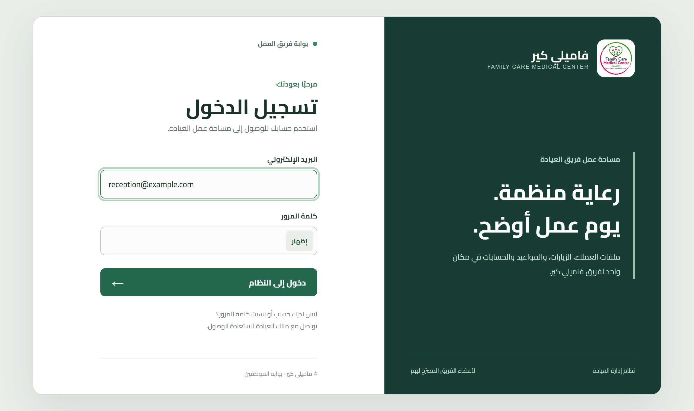
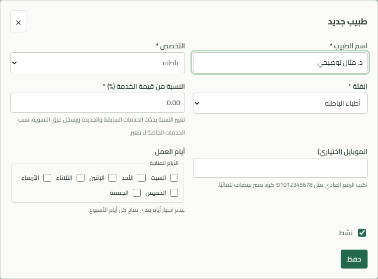
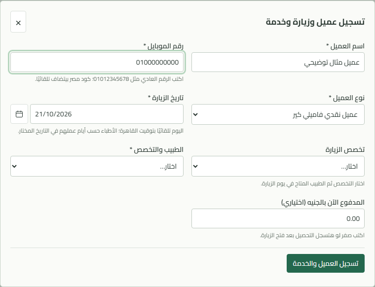

# دليل استخدام نظام فاميلي كير

**الإصدار:** 2.0 — **تاريخ المراجعة:** 21/10/2026

[نسخة PDF جاهزة للطباعة والمشاركة](family-care-user-guide-ar.pdf)

> **ما المنشور الآن وما الجاهز للإصدار القادم؟**
> الموقع الحالي https://family-care-4le.pages.dev يعمل بالنسخة السابقة. هذا الدليل يشرح النسخة الجديدة الجاهزة للإصدار. الخصائص المعلّمة بعلامة **[إصدار جديد]** تظهر بعد أن يوافق المالك على الإصدار ويُنشر. باقي الخطوات تعمل الآن بنفس الطريقة.
> الأمثلة كلها بأسماء وأرقام وهمية.

## المحتويات

1. البداية: الدخول والخروج والتنقل
2. الصلاحيات: المالك والاستقبال والطبيب
3. حسابات الموظفين
4. التخصصات والخدمات وفئات الأطباء
5. الأطباء وأيام العمل
6. العملاء: التسجيل والكود الدائم والأرقام المشتركة
7. تسجيل عميل وزيارة وعدة خدمات معًا
8. الزيارة: الخدمات والتحصيل والطباعة
9. المتابعات: استكمال الحساب أو متابعة بسعر مستقل
10. التأمين والنقابات
11. نسب الأطباء وكشف الحساب
12. عقود الإيجار وتحصيله
13. المصروفات
14. التقارير والتصدير
15. العروض والرسائل
16. تقييم العملاء
17. العمليات المالية العكسية والإلغاء
18. رسائل الخطأ الشائعة وحلها
19. قائمة سريعة لموظف الاستقبال
20. قائمة المالك
21. معاني الكلمات

## 1. البداية: الدخول والخروج والتنقل

1. افتح الموقع من الكمبيوتر أو الهاتف.
2. اكتب «البريد الإلكتروني» و«كلمة المرور» اللذين أعطاهما لك المالك. زر «إظهار» يعرض كلمة المرور التي كتبتها للتأكد.
3. اضغط «دخول إلى النظام». تظهر صفحة «اليوم».

4. القائمة الجانبية تعرض الصفحات المسموحة لحسابك فقط. على الهاتف افتحها من زر القائمة ☰.
5. **البحث عن عميل:** اكتب في شريط البحث أعلى الصفحة الاسم أو رقم الموبايل أو كود العميل. اختصار لوحة المفاتيح `Ctrl+K` يضعك في البحث. اضغط `Enter` لفتح أول نتيجة.
6. زر «تحديث» أعلى الصفحة يعيد تحميل البيانات من الخادم. استخدمه إذا عدّل زميل بيانات من جهاز آخر.
7. عند الانتهاء اضغط «تسجيل الخروج» في أسفل القائمة، خصوصًا على جهاز مشترك.

**التواريخ:** كل التواريخ تُكتب وتظهر بصيغة يوم/شهر/سنة، مثل `07/10/2026`. يمكنك كتابة التاريخ بالأرقام العادية أو العربية، أو اختيار التاريخ من زر «فتح التقويم» بجوار الحقل. التاريخ غير الصحيح، مثل `31/04/2026` أو `29/02/2025`، يُرفض برسالة واضحة. **[إصدار جديد]**

**لو ظهرت رسالة «جارٍ فتح العيادة…» لفترة طويلة:** انتظر قليلًا. لو لم تُفتح الصفحة يظهر زر «إعادة المحاولة». اضغطه، ولا تُغلق نافذة فيها تحصيل لم يُحفظ بعد. **[إصدار جديد]**

## 2. الصلاحيات: المالك والاستقبال والطبيب

| الشاشة | المالك | الاستقبال | الطبيب |
|---|---|---|---|
| اليوم، العملاء، المتابعات، التخصصات والخدمات | نعم | نعم | زياراته وعملاؤه فقط |
| مواعيد الدكاترة | نعم | نعم | لا |
| العروض والرسائل، المصروفات | نعم | نعم (المصروفات: ما سجله هو فقط) | لا |
| الأطباء والحسابات | كل الأطباء | لا | «حسابي» فقط |
| التأمين والنقابات، تقييمات العملاء، التقارير، الإعدادات | نعم | لا | لا |

- الصلاحيات مطبقة على البيانات نفسها في الخادم، وليست مجرد إخفاء أزرار.
- **نسب الأطباء ونصيبهم** يراها المالك، ويرى كل طبيب نسبته فقط. الاستقبال يحجز ويسعّر ويحصّل بدون رؤية نسب الأطباء. **[إصدار جديد]**
- الطبيب لا يرى عميلًا إلا إذا كانت له زيارة معه، ولا يرى زيارات العميل مع أطباء أو تخصصات أخرى ولا تحصيلاته.

## 3. حسابات الموظفين (المالك)

### إنشاء حساب استقبال

1. افتح «الإعدادات» ثم تبويب «الحسابات».
2. اضغط «حساب استقبال جديد».
3. اكتب «البريد الإلكتروني» و«كلمة المرور (12 حرفاً على الأقل)» و«اسم الموظف».
4. اضغط «حفظ». يظهر الحساب في الجدول بحالة «نشط».

### إنشاء حساب طبيب مع بياناته

1. في تبويب «الحسابات» اضغط «حساب طبيب جديد».
2. اكتب البريد وكلمة المرور واسم الطبيب.
3. في «إضافة الطبيب» اختر «طبيب جديد — اختار تخصصه».
4. اختر «تخصص الطبيب» أولًا، ثم «فئة الطبيب»، ثم «نسبة الطبيب من الخدمة (%)».
5. اضغط «حفظ». يُنشأ الطبيب وحساب دخوله معًا.

لربط حساب دخول بطبيب مسجل من قبل، اختر «ربط طبيب مسجل بالفعل».

### تعديل أو إيقاف حساب، أو تغيير كلمة المرور

- «تعديل الصلاحية» يغيّر الدور أو يوقف الحساب بإلغاء علامة «نشط».
- إيقاف الحساب يمنع الدخول ويُنهي أي جلسة مفتوحة للموظف فورًا. **[إصدار جديد]**
- «كلمة مرور جديدة» تغيّر كلمة المرور وتُنهي الجلسات المفتوحة للموظف، فيدخل بالكلمة الجديدة فقط. **[إصدار جديد]**
- البريد المسجل من قبل يُرفض برسالة: «البريد مسجل بالفعل. افتح الحساب الموجود من جدول الحسابات.»

## 4. التخصصات والخدمات وفئات الأطباء (المالك)

### تخصص جديد

1. افتح «التخصصات والخدمات» واضغط «إضافة تخصص».
2. اختر التخصص من القائمة أو اكتب «اسم التخصص» بنفسك.
3. «تخصيص الكود والترتيب» اختياري: يظهر «بادئة كود العميل» و«ترتيب العرض». البادئة تخص الأكواد القديمة فقط؛ كود العميل الدائم واحد لكل التخصصات.
4. اضغط «حفظ».

### خدمة جديدة بسعرها

1. اضغط «إضافة خدمة وسعرها».
2. اكتب «اسم الخدمة» واختر «التخصص» واكتب «السعر بالجنيه»، مثل `350`.
3. «خيارات إضافية» يُظهر «التصنيف» و«يشترط ديبوزيت للحجز» و«الديبوزيت بالجنيه».
4. اضغط «حفظ الخدمة وسعرها». يُسجل السعر في كل قوائم الأسعار.

الأسعار المنشورة لا تتغير بعد ذلك، والزيارات القديمة تحتفظ بسعرها وقت الزيارة. لتغيير الأسعار يفتح المالك «الإعدادات ← قوائم الأسعار ← نسخة أسعار جديدة» ويحدد تاريخ السريان.

### حذف واستعادة

زر «حذف» يوقف استخدام التخصص أو الخدمة في الحجوزات الجديدة. السجل لا يُمسح، والزيارات القديمة تحتفظ بأسعارها. علّم «إظهار المحذوف» ثم اضغط «استعادة» لإرجاعه.

### فئات الأطباء **[إصدار جديد]**

في نموذج الطبيب اختر **التخصص أولًا**، فتتغير الفئة الأولى حسبه:

| التخصص | الفئات المتاحة |
|---|---|
| أسنان | أطباء الأسنان، أطباء مستأجرين، أطباء نسبة |
| باطنة | أطباء الباطنة، أطباء مستأجرين، أطباء نسبة |
| أي تخصص يضيفه المالك، مثل «تخاطب» | أطباء التخاطب، أطباء مستأجرين، أطباء نسبة |

تغيير التخصص يغيّر اسم الفئة الأولى فورًا، ويحتفظ باختيار «أطباء مستأجرين» أو «أطباء نسبة» كما هو. الاسم للعرض فقط؛ لا يغيّر نسبة أو عقدًا أو حسابًا.

## 5. الأطباء وأيام العمل

### طبيب جديد (المالك)

1. افتح «الأطباء والحسابات» واضغط «طبيب جديد».
2. اكتب «اسم الطبيب» واختر «التخصص»، ثم «الفئة».
3. اكتب «النسبة من قيمة الخدمة (%)»، مثل `30`.
4. في «أيام العمل» علّم الأيام التي يحضر فيها الطبيب. ترك الأيام بلا علامات يعني أنه متاح كل الأسبوع.
5. اضغط «حفظ».

### معرفة أيام وجود الدكتور (الاستقبال والمالك)

افتح «مواعيد الدكاترة»، واختر «التخصص»، فتظهر أيام عمل كل دكتور.

عند الحجز، قائمة الأطباء تعرض فقط المتاحين في تاريخ الزيارة المختار. لذلك اختر التاريخ أولًا، ثم «تخصص الزيارة»، ثم الطبيب.

## 6. العملاء: التسجيل والكود الدائم والأرقام المشتركة

### كود العميل الدائم **[إصدار جديد]**

- كل عميل له كود واحد دائم مثل `FC-000123`، لكل التخصصات.
- العميل الذي كشف أسنان اليوم ويكشف جلدية الأسبوع القادم يُحجز له من نفس الملف وبنفس الكود. **لا تسجّله مرة ثانية.**
- الكود لا يتغير أبدًا، حتى لو عدّلت الاسم أو التخصص.
- الأكواد القديمة المطبوعة، مثل `DEN-000382`، ما زالت تفتح نفس الملف من البحث.
- الكود يظهر في البحث وملف العميل وصفحة الزيارة والإيصالات والفواتير الجديدة.

### عميل جديد بدون زيارة

1. افتح «العملاء» واضغط «عميل فقط».
2. اكتب «اسم العميل» و«رقم الموبايل». الرقم المحلي مثل `01012345678` يُحفظ تلقائيًا بالصيغة الدولية `+201012345678`.
3. اختر «نوع العميل». لو «تأمين آجل» اختر «شركة التأمين»، ولو «نقابة» اختر «النقابة».
4. «التخصص (اختياري)» يستخدم للعروض والرسائل حسب التخصص فقط.
5. اختر الموافقات كلٌّ على حدة: «وافق على رسائل العروض وأعياد الميلاد»، و«وافق على رسائل مواعيد المتابعة». اترك غير الموافق عليه بدون علامة.
6. اضغط «حفظ». يفتح ملف العميل.

### رقم موبايل مسجل لعميل آخر **[إصدار جديد]**

أفراد الأسرة قد يستخدمون رقمًا واحدًا. عند كتابة رقم مسجل من قبل:

1. تظهر رسالة «الرقم مسجل بالفعل باسم:» مع زر «فتح ملف …» لكل عميل بهذا الرقم.
2. لو هو نفس العميل، اضغط «فتح ملف …» واحجز له من ملفه. لا تُنشئ ملفًا جديدًا.
3. لو هو فرد آخر من الأسرة، علّم «ملف منفصل لنفس الرقم (فرد آخر من الأسرة)» ثم اضغط «حفظ».

النظام لا يدمج أي ملفين تلقائيًا أبدًا.

## 7. تسجيل عميل وزيارة وعدة خدمات معًا

**مثال:** عميل جديد يريد كشف أسنان اليوم مع خدمتين.

1. افتح «العملاء» واضغط «تسجيل عميل وخدمة».
2. اكتب الاسم والرقم واختر «نوع العميل».
3. «تاريخ الزيارة» هو اليوم تلقائيًا بتوقيت القاهرة. غيّره أولًا لو الحجز ليوم آخر.
4. اختر «تخصص الزيارة» ثم «الطبيب والتخصص» ثم «الخدمة».
5. لإضافة خدمة أخرى اضغط «إضافة خدمة أخرى» واختر الخدمة والعدد. زر «إلغاء الخدمة» بجانبها يحذفها من المسودة قبل الحفظ.
6. لعميل تأمين أو نقابة اكتب «نسبة تحمّل العميل من الكارنيه (%)» لهذه الزيارة. تظهر المعاينة: «العميل عليه … جنيه · على الجهة … جنيه».
7. اختياري: «المدفوع الآن بالجنيه» و«طريقة الدفع».
8. اضغط «تسجيل العميل والخدمة». تفتح صفحة الزيارة.

**عميل مسجل من قبل:** ابحث عنه، وافتح ملفه، واضغط «زيارة جديدة». ثم اختر التاريخ، و«تخصص الزيارة»، والطبيب، والخدمة، واضغط «تسجيل الزيارة والخدمة». «حجز فقط» يحجز موعدًا بدون خدمة. الزيارة المنزلية تضيف 1,000 جنيه مرة واحدة.

## 8. الزيارة: الخدمات والتحصيل والطباعة

### إضافة خدمة

- قبل أي تحصيل: «إضافة خدمة» لإضافة خدمة، و«إلغاء الخدمة» لحذف خدمة أُضيفت بالخطأ.
- **بعد التحصيل:** «إضافة خدمة» ما زال متاحًا ويزيد إجمالي الزيارة. الإيصالات القديمة لا تتغير، ولا يمكن حذف خدمة عليها تحصيل؛ التصحيح يكون بعملية عكسية مسجلة (القسم 17).

### تحصيل جزئي والمتبقي

**مثال:** إجمالي الزيارة 600 جنيه.

1. اضغط «تسجيل تحصيل».
2. اكتب «المبلغ بالجنيه» `200`، واختر «طريقة الدفع» و«النوع»: «تحصيل» أو «ديبوزيت حجز».
3. اضغط «تسجيل وطباعة الإيصال». يظهر الإيصال وفيه المتبقي: 400 جنيه. اضغط «طباعة الإيصال» أو «إغلاق».
4. في الزيارة التالية افتح نفس الزيارة وسجّل 400 جنيه، فيصبح المتبقي 0 جنيه.

- لا يقبل النظام مبلغًا أكبر من المتبقي.
- الضغط مرتين على زر التحصيل، أو انقطاع الإنترنت ثم إعادة المحاولة من نفس النافذة، لا يسجل الإيصال مرتين.
- كل إيصال يحفظ اسم الموظف الذي حصّله.

### الكشف وإنهاء الزيارة

اضغط «الكشف وإنهاء الزيارة»، واكتب «التشخيص / ملاحظات الكشف» واختياريًا «تعليمات العميل»، ثم «حفظ وإنهاء الزيارة». الطبيب يستحق نصيبه عند إنهاء الزيارة، حتى لو لم يُحصّل كل المبلغ بعد.

### الفاتورة والعروض

- «عرض / طباعة الفاتورة» يعرض الخدمات والمدفوع والمتبقي، و«طباعة الفاتورة» يطبعها.
- «تطبيق كود عرض»: اكتب «كود العرض» واضغط «تطبيق العرض» قبل أي تحصيل.

## 9. المتابعات: استكمال الحساب أو متابعة بسعر مستقل

من الزيارة اضغط «متابعة جديدة» واختر «حساب المتابعة»:

- **«استكمال نفس الخدمة / تحصيل الباقي»:** لا تُضاف خدمة جديدة ولا يُحسب السعر مرة ثانية. في يوم المتابعة يُحصّل الباقي من نفس الحساب.
- **«متابعة بسعر مستقل»:** اكتب «سعر المتابعة بالجنيه»، مثل `200`. المبلغ على العميل بالكامل، حتى لو كان تأمينًا أو نقابة.

**التاريخ الفائت:** لو كتبت تاريخًا قبل اليوم يظهر «تأكيد: التاريخ ده فات، وهتتسجل كمتابعة متأخرة». علّمه فقط لو تسجّل متابعة قديمة عن قصد. **[إصدار جديد]**

### يوم المتابعة (صفحة «المتابعات»)

1. اختر من «عرض»: «اليوم» أو «متأخرة» أو «قادمة» أو «كل المتابعات».
2. **استكمال الحساب:** اضغط «استكمال نفس الحساب»، وسجّل تحصيل الباقي، ثم ارجع واضغط «دخول بعد السداد».
3. **بسعر مستقل:** اضغط «فتح / تحصيل المتابعة» ثم «فتح الحساب». حصّل المبلغ، ثم اضغط «دخول بعد السداد».
4. بعد الدخول تنتقل المتابعة إلى عرض «اليوم». اضغط «إنهاء المتابعة» بعد الكشف.
5. «تغيير الموعد» ينقل المتابعة لتاريخ جديد ويحتفظ بالموعد القديم في السجل. «لم يحضر» يغلقها كغياب.

زر «دخول بعد السداد» لا يعمل قبل سداد المطلوب.

## 10. التأمين والنقابات

### الإعداد (المالك)

افتح «التأمين والنقابات». اضغط «إضافة شركة تأمين» أو «إضافة نقابة»، واكتب الاسم وبيانات التواصل. إلغاء علامة «نشطة ومتاحة للاستقبال» يوقف اختيارها للعملاء الجدد فقط.

### في كل زيارة

اكتب «نسبة تحمّل العميل من الكارنيه (%)».

**مثال:** زيارة 300 جنيه ونسبة العميل 20%: العميل يدفع 60 جنيه، والجهة عليها 240 جنيه. حصة العميل تُقرَّب لأقرب قرش، وحصة الجهة هي الباقي بالضبط، فالمجموع دائمًا مساوٍ للإجمالي.

### التسوية

1. بعد إنهاء الزيارة تصبح حصة الجهة مستحقة في حسابها.
2. في صف الجهة اضغط «تسوية»، واكتب «المبلغ بالجنيه» و«مرجع التحويل / التسوية»، ثم «تسجيل التسوية».
3. لا يقبل النظام تسوية أكبر من المتبقي على الجهة.

## 11. نسب الأطباء وكشف الحساب

- النسبة الافتراضية تُكتب في نموذج الطبيب. «نسبة خدمة» يحدد نسبة مختلفة لخدمة معينة، وهي تتقدم على النسبة الافتراضية.
- **الاستحقاق** عند إنهاء الزيارة، من قيمة الخدمة بعد الخصم، ومستقل عن التحصيل.
- **مثال:** خدمة 300 جنيه ونسبة 33.33% تعطي 99.99 جنيه للطبيب.
- **تعديل النسبة لاحقًا** يُسجل تسوية عمولة مؤرخة على الخدمات السابقة أيضًا. السطر الأصلي والإيصالات لا تتغير، ويظهر «فرق تعديل النسبة» في الكشف. مثال: خدمة 300 جنيه منتهية بنسبة 33.33% (99.99 جنيه)، عدّلت النسبة إلى 50%، فيصبح المستحق 150 جنيه، والفرق 50.01 جنيه.
- **كشف الحساب:** في «الأطباء والحسابات» اختر الطبيب وحدد «من» و«إلى»، ثم «عرض الحساب». «تصدير CSV» و«طباعة» للحفظ.
- الطبيب يرى كشفه من «حسابي».

لو ظهرت رسالة «نسب الأطباء غير متاحة الآن من الخادم» فتعديل الطبيب ونسبة الخدمة موقوفان مؤقتًا، حتى لا تُحفظ نسبة خاطئة. حدّث الصفحة بعد قليل. **[إصدار جديد]**

## 12. عقود الإيجار وتحصيله (المالك)

1. للطبيب من فئة «أطباء مستأجرين» اضغط «عقد إيجار». اكتب «الإيجار بالجنيه» واختر «الدورية» («شهري» أو «فترة محددة»)، واكتب «بداية العقد» و«الغرفة / وصف المكان»، ثم «حفظ».
2. يظهر الإيجار المستحق لكل فترة في جدول العقد.
3. لتسجيل ما دفعه الطبيب اضغط «تحصيل إيجار» واكتب «المبلغ بالجنيه». يتوزع المبلغ على فترات الإيجار غير المدفوعة، ولا يُقبل مبلغ أكبر من إجمالي المتبقي.
4. «إغلاق العقد» يوقف حساب مستحقات جديدة.
5. «عكس التحصيل» في جدول «تحصيلات الإيجار» يلغي تحصيلًا مسجلًا بالخطأ (القسم 17).

## 13. المصروفات

1. افتح «المصروفات» واضغط «تسجيل مصروف».
2. اكتب «المبلغ بالجنيه» و«تاريخ المصروف» (لا يُقبل تاريخ مستقبلي)، واختر «البند» و«طريقة الدفع»، واكتب «سبب الصرف» و«اسم المستلم (اختياري)».
3. اضغط «حفظ المصروف».

- الاستقبال يرى المصروفات التي سجلها هو فقط، والمالك يرى الكل.
- «تفصيل حسب البند» يجمع المصروفات حسب نوعها.
- «تصدير CSV» و«طباعة» للحفظ.

## 14. التقارير والتصدير (المالك)

افتح «التقارير» وحدد «من» و«إلى». الإجماليات: العملاء، والتأمين، والإيجارات، ونصيب الأطباء المستحق، والمصروفات، و«التحصيل ناقص مستحق الأطباء والمصروفات».

- الإجماليات تُحسب في الخادم مرة واحدة لكل الفترة. **[إصدار جديد]**
- لو لم يكن رقم متاحًا يظهر «—» وليس صفرًا.
- «تصدير التحصيل CSV» يُخرج الإيصالات، ومعها «سجّل التحصيل» (اسم الموظف). «طباعة التقرير» للطباعة.
- «سجل التعديلات المالية» يعرض العمليات الحساسة مثل رد المبالغ وتعديل النسب.

## 15. العروض والرسائل

### العروض

1. افتح «العروض والرسائل» واضغط «عرض جديد».
2. اكتب «عنوان العرض» واختر «التخصص» واكتب «كود العرض». اختر «نوع الخصم» («نسبة» أو «مبلغ») والقيمة، وحدد الفترة «من» و«إلى».
3. اختياري: «حد الاستخدام» لعدد مرات كلي، و«يشمل الباقات»، و«يستخدم في رسالة عيد الميلاد».
4. **«مرة واحدة لكل عميل»:** يمنع نفس العميل من استخدام العرض مرة ثانية، حتى لو حاول جهازان في نفس اللحظة. العروض القديمة تبقى متكررة كما كانت. استخدام العرض يُحتسب حتى لو أُلغيت الزيارة بعده. **[إصدار جديد]**

### الرسائل

- **الرسائل لا تُرسل فعليًا الآن.** النظام يسجلها في السجل بحالة «مسجلة تجريبياً» فقط. لا يوجد إرسال واتساب أو SMS أو بريد.
- «معاينة المستلمين» يعرض عدد العملاء الموافقين على العروض فقط، و«تسجيل إرسال تجريبي» يسجل الحملة في السجل.
- تذكيرات المتابعة تُسجل للعملاء الموافقين على رسائل المتابعة فقط، وغير الموافق يُسجل له «لم تُرسل».
- «تشغيل فحص التذكيرات الآن» يُجري الفحص فورًا بدل انتظار الفحص التلقائي.

## 16. تقييم العملاء

- بعد إنهاء الزيارة يُنشأ رابط تقييم للعميل الموافق على رسائل المتابعة. الرابط صالح 30 يومًا ولمرة واحدة، ولا يعرض اسم العميل.
- لأن الرسائل غير مُرسلة فعليًا، الرابط لا يصل للعميل تلقائيًا.
- النتائج تظهر في «تقييمات العملاء» للمالك فقط.

## 17. العمليات المالية العكسية والإلغاء

لا شيء من هذه العمليات يمسح السجل الأصلي، وكلها تُسجل في «سجل التعديلات المالية». **ولا واحدة منها تُحوّل أموالًا**: لو رددت نقودًا للعميل أو الطبيب فهذا يتم يدويًا خارج النظام.

| العملية | من يستخدمها | متى | أثرها على الأرصدة | ما يبقى مسجلًا |
|---|---|---|---|---|
| «رد المبلغ» في جدول إيصالات الزيارة | المالك | إيصال مسجل بالخطأ أو مبلغ أُعيد للعميل | يُخصم الإيصال بالكامل من المدفوع، ويرتفع المتبقي على العميل بنفس المبلغ | الإيصال الأصلي، وقيد «رد مبلغ» جديد |
| «عكس التحصيل» في جدول تحصيلات الإيجار | المالك | تحصيل إيجار مسجل بالخطأ | يُلغى التحصيل المختار بالكامل، ويعود الإيجار المستحق كما كان | الإيصال الأصلي بحالة «اتعكس»، وقيد «عكس تحصيل» |
| «عكس التسوية» في جدول تسويات الجهات | المالك | تسوية تأمين أو نقابة مسجلة بالخطأ | تعود حصة الجهة مستحقة بنفس المبلغ | التسوية الأصلية بحالة «اتعكست»، وقيد «عكس تسوية» |
| «إلغاء الزيارة» | المالك | زيارة بلا تحصيل ولا فاتورة جهة | تصبح الزيارة «ملغاة»، والمتبقي عليها 0 جنيه | الزيارة وأسعارها كما سُجلت |
| «إلغاء المصروف» مع «سبب الإلغاء» | المالك | مصروف مسجل بالخطأ | لا يدخل في الإجماليات | المصروف بحالة «ملغى» مع السبب واسم من ألغاه |

**إلغاء زيارة عليها تحصيل:** اعكس التحصيل أولًا بـ«رد المبلغ»، ثم ألغِ الزيارة. وإلا تظهر رسالة «اعكس التحصيل والتسويات أولاً للحفاظ على الحسابات».

### «عكس التحصيل» في الإيجار بالتفصيل

يلغي تحصيل الإيجار المختار **بالكامل**، ويحتفظ بالإيصال الأصلي، ويُنشئ قيد عكس، ويُرجع الإيجار المستحق المرتبط به. لا يُرجع نقودًا ولا يحوّل أموالًا تلقائيًا، ولا يغيّر نسبة الطبيب أو نصيبه.

**مثال:**

| | قبل العكس | بعد عكس تحصيل 1,000 جنيه |
|---|---|---|
| الإيجار المستحق | 2,000 جنيه | 2,000 جنيه |
| صافي المدفوع | 1,000 جنيه | 0 جنيه |
| المتبقي | 1,000 جنيه | 2,000 جنيه |

## 18. رسائل الخطأ الشائعة وحلها

| الرسالة | الحل |
|---|---|
| اكتب رقم موبايل مصري صحيحاً | اكتب 11 رقمًا يبدأ بـ 010 أو 011 أو 012 أو 015 |
| الرقم مسجل لعميل آخر… | افتح الملف الموجود، أو علّم «ملف منفصل لنفس الرقم» |
| اكتب تاريخًا صحيحًا بصيغة يوم/شهر/سنة | مثل 07/10/2026 |
| الطبيب غير متاح في اليوم المختار | اختر تاريخًا من «أيام العمل» أو طبيبًا آخر |
| المبلغ لازم يكون أكبر من صفر ولا يزيد عن المتبقي | راجع المتبقي في الزيارة |
| الفاتورة اتسجل عليها تحصيل… | لا يمكن حذف خدمة عليها تحصيل؛ استخدم الرد المسجل |
| كود العرض غير موجود لهذا التخصص / العرض موقوف حالياً / العرض خارج فترة الصلاحية | راجع الكود والتخصص والتاريخ |
| العميل استخدم هذا العرض من قبل… | العرض مسموح مرة واحدة لكل عميل |
| حصّل المتبقي من الحساب القديم وحساب المتابعة أولاً… | سدد المطلوب ثم «دخول بعد السداد» |
| انتهت الجلسة. سجّل الدخول من جديد. | سجّل الدخول مرة أخرى |
| تعذر تنفيذ الإجراء. راجع اتصال الإنترنت… | تأكد من الإنترنت، ثم أعد المحاولة من نفس النافذة؛ التحصيل لا يتكرر |

## 19. قائمة سريعة لموظف الاستقبال

1. سجّل الدخول، وتأكد من تاريخ «اليوم».
2. للعميل الجديد: ابحث بالرقم أولًا. لو ظهر عميل بنفس الرقم، افتح ملفه أو أكّد «ملف منفصل».
3. للعميل القديم: ابحث بالاسم أو الرقم أو الكود (الجديد أو القديم)، وافتح ملفه، واضغط «زيارة جديدة».
4. اختر التاريخ ثم «تخصص الزيارة» ثم الطبيب المتاح ثم الخدمة.
5. لعميل التأمين أو النقابة اكتب نسبة التحمل لهذه الزيارة.
6. سجّل التحصيل، واطبع الإيصال، وراجع المتبقي.
7. عند وصول العميل اضغط «حضر» في صفحة «اليوم».
8. سجّل المتابعة، واختر «استكمال نفس الخدمة / تحصيل الباقي» أو «متابعة بسعر مستقل».
9. في يوم المتابعة: حصّل المطلوب، ثم «دخول بعد السداد».
10. سجّل المصروفات التي صرفتها.
11. قبل المغادرة اضغط «تسجيل الخروج».

## 20. قائمة المالك

- راجع الحسابات وأوقف حساب أي موظف ترك العمل.
- راجع التخصصات والخدمات والأسعار، وأيام عمل الأطباء ونسبهم وعقود الإيجار.
- راجع أرصدة التأمين والنقابات وسجّل التسويات.
- راجع «التقارير» و«سجل التعديلات المالية» أسبوعيًا.
- راجع المصروفات وألغِ الخطأ منها بسبب واضح.
- استخدم «رد المبلغ» و«عكس التحصيل» و«عكس التسوية» فقط بعد التأكد؛ كلها تبقى مسجلة.
- راجع «تقييمات العملاء».

## 21. معاني الكلمات

| الكلمة | المعنى |
|---|---|
| كود العميل | الكود الدائم للعميل مثل FC-000123، واحد لكل التخصصات |
| كود قديم | كود التخصص السابق مثل DEN-000382، يُستخدم في البحث فقط |
| المتبقي | ما بقي على العميل في الزيارة بعد التحصيلات |
| نسبة التحمّل | الجزء الذي يدفعه عميل التأمين أو النقابة من الزيارة |
| حصة الجهة | ما على شركة التأمين أو النقابة دفعه |
| التسوية | تسجيل مبلغ استلمته العيادة من الجهة |
| مستحق الطبيب | نصيب الطبيب من الخدمات المنتهية |
| استكمال الحساب | متابعة بدون سعر جديد، يُحصّل فيها الباقي فقط |
| متابعة بسعر مستقل | متابعة لها سعر خاص يدفعه العميل |
| رد / عكس | قيد جديد يلغي أثر عملية سابقة، مع بقاء الأصل مسجلًا |
| ديبوزيت | مبلغ يُدفع لتأكيد الحجز |

## تحديثات 19/11/2026 [بعد تحديث القاعدة]

- **الدفع بمبلغ أكبر من المطلوب:** الاستقبال يقدر يسجّل مبلغ أكبر من المتبقي (مثلًا الحساب 2999 والعميل دفع 3000). المتبقي بيتقفل، والفرق بيتسجل «إيراد زيادة»، ومش بيترجع للعميل ولا بيتحسب له رصيد. بيظهر في التقارير المالية كسطر لوحده.
- **وقت الحجز:** الوقت بقى مطلوب في كل نموذج حجز. الدكتور ما ينفعش يكون عنده حجزين في نفس الدقيقة، لكن نفس الوقت ينفع مع دكتور تاني. الحجز الملغي بيفضّي الوقت.
- **مواعيد شغل الدكتور:** من «الأطباء» حدد أيام الشغل وساعات كل يوم. لما تختار الدكتور في الحجز بتظهر مواعيده تحته. لو الحجز في يوم إجازته أو برا ساعاته بيظهر تنبيه، ولازم تعلّم «تأكيد الحجز خارج مواعيد الطبيب» عشان يتحفظ، والحجز ده بيتسجل في سجل التعديلات.
- **أسعار الخدمات لكل جهة:** من «التأمين» اضغط «أسعار الخدمات» في صف الشركة أو النقابة، واكتب سعر الجهة لكل خدمة (سيبه فاضي عشان يتطبق سعر فاميلي كير). السعر بيتطبق على الخدمات اللي تتضاف لعملاء الجهة بعد الحفظ، والزيارات القديمة ما بتتغيرش.
- **صفحة «اليوم»:** عمود «التخصص» جنب اسم الطبيب.
- **الحجز:** كل التخصصات النشطة بتظهر حتى لو مالهاش دكتور أو خدمة، مع تنبيه.
- **التأمين:** «إجمالي حصة الشركة» بقت «إجمالي حصة التأمين».

## تقفيل اليوم (الاستقبال والمالك) — 19/11/2026
1. افتح «تقفيل اليوم» من القائمة واختار اليوم.
2. هتلاقي عدد المرضى في «يومية النسبة» و«يومية المستأجرين»، والإيرادات لكل طريقة دفع (انستاباي، فيزا، محفظة، كاش)، وإجمالي المصروفات.
3. «الكاش في الدرج» = المتبقي من حساب امس + كاش النهارده − مصروفات الكاش. انستاباي وفيزا والمحفظة مش بيدخلوا الدرج.
4. اكتب المبلغ اللي اتبعت للمالك واسم اللي استلمه، ودوس «تقفيل اليوم». الباقي بيترحل لوحده لليوم اللي بعده في «متبقي من حساب امس».
5. التقفيل مرة واحدة لكل يوم وبالترتيب. لو فيه غلط، المالك بس يقدر يفتح آخر يوم متقفل ويتقفل تاني.
6. نسب الدكاترة ومستحقاتهم اللي بتتصرف كاش من الدرج اتسجّل كمصروف بطريقة دفع «كاش» عشان تتخصم من الدرج.

## تعديل تحصيل اتسجل غلط — 19/11/2026
- في صفحة الزيارة، جدول «التحصيل والإيصالات»، زرار «تعديل» جنب كل إيصال.
- اكتب المبلغ الصحيح وطريقة الدفع الصحيحة وسبب التعديل. الإيصال الأصلي بيفضل محفوظ وعليه «اتعدل»، وبيتسجل إيصال رد عليه «إلغاء بسبب تعديل» وإيصال جديد عليه «تصحيح».
- الاستقبال يعدّل تحصيل النهارده بس وقبل تقفيل اليوم. المالك يعدّل أي تحصيل في أي وقت، والتعديل بيتحسب في تحصيل يوم التعديل.

## إلغاء حجز — 19/11/2026
من صفحة «اليوم» دوس «إلغاء الحجز» واختار: استرداد المبلغ بالكامل، أو رد جزئي (اكتب المبلغ اللي هيرجع)، أو لن يتم استرداد المبلغ. المبلغ اللي بيرجع بيتسجل بنفس طريقة الدفع في تحصيل وتقفيل النهارده، والباقي بيفضل إيراد للعيادة. الزيارة بتتلغي ومش بيتحسب عليها نسبة للدكتور.

## حذف حساب موظف — 19/11/2026
الإعدادات › الحسابات › «حذف الحساب». الموظف مش هيقدر يدخل تاني والحساب يختفي من القائمة، واسمه يفضل في السجلات القديمة. «إظهار الحسابات المحذوفة» › «استعادة الحساب» لو رجع.

## قوالب الرسائل — 19/11/2026
الإعدادات › قوالب الرسائل: فوق جدول بكل المتغيرات ومعناها. «إنشاء قالب جديد» لقالب حملة عروض: دوس على المتغير يتحط في النص، وتحت بيظهر شكل الرسالة للعميل. في «العروض والرسائل» اختار القالب من «نص الرسالة» قبل الإرسال.

## الموظفين (المالك) — 19/11/2026
المصروفات › «الموظفين»: «موظف جديد» (الاسم، الوظيفة، تاريخ التعيين، بدأ بمرتب، مرتبه الحالي). لكل موظف في الشهر: سلفة، خصم، مكافأة، صرف المرتب، والمتبقي له بيتحسب لوحده. دوس على اسم الموظف تشوف تقريره والشهور اللي فاتت، ومن هناك تلغي حركة غلط بسبب. السلفة وصرف المرتب بيظهروا في المصروفات وتقفيل اليوم.

## معمل الأسنان — 19/11/2026
«معمل الأسنان» من القائمة: «شغل جديد للمعمل» (المريض، الدكتور، حالة التركيبة والنوع، راحت المعمل، الأسيستنت، اسم المعمل، السعر). «رجعت النهارده» لما الشغل يرجع، و«دفع للمعمل» بيسجل المصروف. الفلاتر بالتاريخ والحالة والدكتور، وفيه تصدير CSV وطباعة.

## تحديثات 20/11/2026

- **صفحة «الأسعار» (للمالك):** جدول واحد فيه كل الخدمات، وعمود لكل نوع عميل (نقدي فاميلي كير، نقدي عيادات مصر، آجل تأمين، أقارب ومعارف، نقدي نقابة). عدّل الخانات اللي عايزها واضغط «حفظ». الخانة اللي اتغيرت بتتلوّن. الأسعار الجديدة بتشتغل من النهارده، والزيارات القديمة ما بتتغيرش. لو اتسجل حجز النهارده بالأسعار الحالية، التعديل بيبدأ من بكرة وبيظهرلك تنبيه.
- **سعر شركة أو نقابة معينة:** لو جهة ليها سعر مختلف عن عمودها، حدده من «التأمين والنقابات» ← «أسعار الخدمات».
- **القائمة الجانبية:** مقسومة «الشغل اليومي» و«الإدارة» و«المتابعة». «الإعدادات والحسابات» فيها الحسابات وقوالب الرسائل وإعدادات العيادة بس.
- **تسجيل الخروج:** زرار في الشريط اللي فوق، جنب اسمك.
